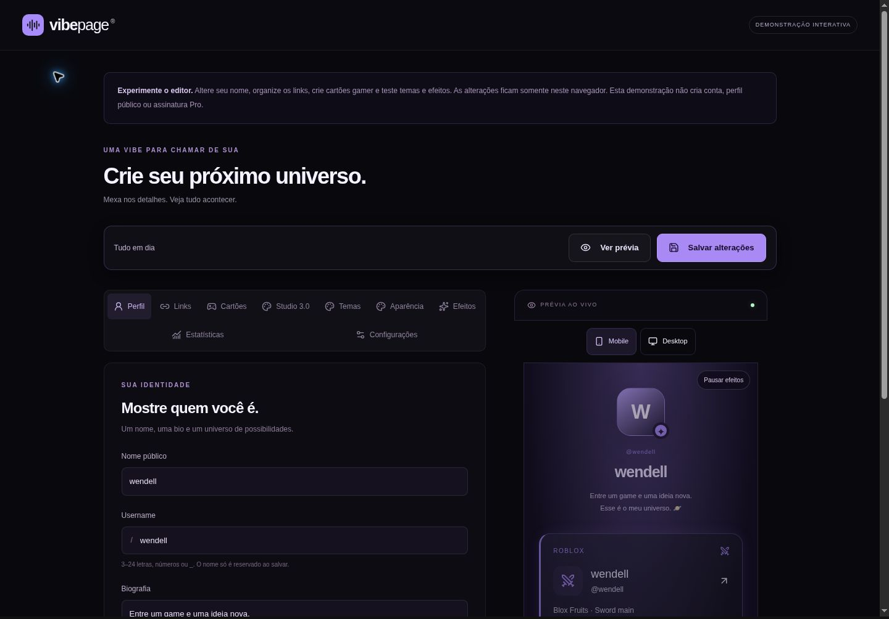
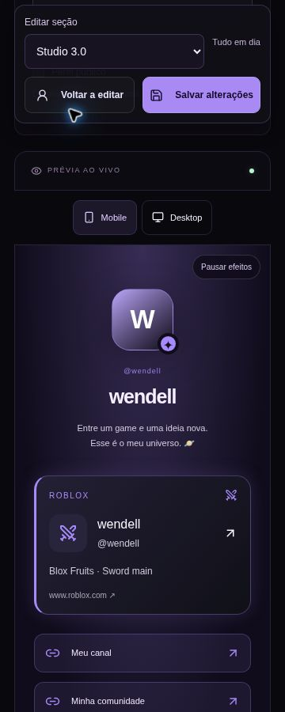

# Revisão final de lançamento — VibePage 3.0

27/10/2026. Escopo: somente `vibepage/` em `wll777z/project-IA`. Base conferida pelo GitHub: `feature/vibepage-next-level`, `07d1e8cec4be202033136f32cd32919ffa527a6a`. Branch: `audit/vibepage-final-release`. Sem merge, deploy, serviços pagos, alteração de credenciais ou dados reais. Fixtures novas são isoladas e sintéticas.

## Decisão

| Destino                         | Decisão atual | Condições que faltam                                                                                                                |
| ------------------------------- | ------------- | ----------------------------------------------------------------------------------------------------------------------------------- |
| Homologação local com fixtures  | GO            | Respeitar os limites documentados e nunca apontar testes ao banco real                                                              |
| Beta fechado com usuários reais | **NO-GO**     | Node/HTTPS/PostgreSQL persistente, homologação nativa, backup/restauração, entrega real de e-mail, responsáveis e canal operacional |
| Lançamento público              | **NO-GO**     | Gates do beta mais moderação/denúncias, dados legais/etários, carga/proxy/monitoramento e aceitação em dispositivos/acessibilidade  |
| Comercialização do Pro          | **NO-GO**     | Gates públicos, cobrança autorizada e condições/operação comercial; não existe checkout ou assinatura à venda                       |

Aprovação de testes PGlite ou de uma demo estática não aprova nenhum dos três lançamentos com usuários reais. Os P0 operacionais abaixo permanecem sem evidência de solução.

## Inventário de branches e integração

A API GitHub confirmou `main` no MVP `080141f`; Next Level segue no SHA informado. PRs #1, #2, #3, #4 e #5 estavam abertos e sem merge no início desta revisão. `git merge-base --is-ancestor` confirmou #1/launch-readiness, #2/ultimate e #3/ultimate-release como ancestrais de Next Level. #4/pro-2-launch contém apenas o CTA `/demo` já presente, não uma versão mais completa.

Caminho para revisão humana: incorporar **PR #3** (inclui #1/#2), depois **PR #5**, depois este PR incremental sobre Next Level. Não aplicar de novo as mesmas correções de #1/#2/#4. O responsável pode encerrar PRs substituídos depois de comparar o conteúdo; esta auditoria não os fechou nem mergeou. As sete migrations existentes estão intactas: [checksums](evidence/migrations.sha256). Schema e dependências não foram alterados. Não houve novos temas, cartões, layouts ou efeitos.

## Achados, evidência e tratamento

P0 bloqueia lançamento; P1 deve estar resolvido antes do beta público; P2 é melhoria/validação complementar. “Pendente” não significa vulnerabilidade reproduzida: indica uma aceitação operacional ainda não demonstrada.

| ID / nível / estado      | Arquivo ou área                                                             | Comportamento e evidência                                                                                                                                                                                | Impacto / correção ou ação necessária                                                                                                                                                                                                                      |
| ------------------------ | --------------------------------------------------------------------------- | -------------------------------------------------------------------------------------------------------------------------------------------------------------------------------------------------------- | ---------------------------------------------------------------------------------------------------------------------------------------------------------------------------------------------------------------------------------------------------------- |
| C1 / P1 / corrigido      | `src/lib/profiles.ts`, `appearance.ts`                                      | O editor normalizava Pro para Free e o save gravava essa normalização sobre campos privados. Teste novo antes da correção falhou: `backgroundKey` virava null; estilos/efeitos também eram sobrescritos. | Retém apresentação Pro existente após validar o payload Free. DTO público continua limitado. Reativação autorizada recupera aparência; identidade e escolhas Free explícitas continuam editáveis. Teste preserva fundo/tema/efeitos/estilos e reativa Pro. |
| C2 / P1 / corrigido      | `profiles.ts`, `gamer-card-editor.tsx`                                      | Teste novo antes da correção: salvar identidade com 12 cartões legados retornava erro Pro, exigindo apagar nove para seguir.                                                                             | Save mantém IDs legados, sem obrigar exclusão; só três aparecem publicamente. Free não pode acrescentar IDs novos enquanto estiver acima de três. Conteúdo pode ser editado e exclusões explícitas continuam possíveis.                                    |
| C3 / P1 / corrigido      | `src/app/[username]/opengraph-image.tsx`                                    | O handler gerava PNG público sem consumir rate limit; QR/VibeCard já possuíam limites.                                                                                                                   | Limite 12/min por identidade confiável (ou bucket compartilhado), antes da geração. Smoke standalone esgota o bucket isolado e comprova 429/no-store. Não substitui limites de conexão/CPU no proxy.                                                       |
| C4 / P1 / corrigido      | `src/app/globals.css`                                                       | Chrome/frame: editor 360 px tinha área útil 345 e scrollWidth 387; em 390, 375/387. Uploads impunham largura intrínseca à grade.                                                                         | Trilha `minmax(0,1fr)` e uploads em uma coluna abaixo de 600 px. Conferência posterior e observações em `evidence/browser-layout-after.json`. Sem redesign.                                                                                                |
| C5 / P1 / corrigido      | `globals.css`, `.profile-scene`                                             | Landing em 768 px: área útil 753, scrollWidth 817; DOM identificou somente órbitas decorativas ultrapassando o viewport.                                                                                 | Conter a decoração na própria cena entre 761 e 1050 px. Layout/identidade/conteúdo preservados. Evidência antes/depois nos JSONs do browser.                                                                                                               |
| O1 / P0 / pendente       | `Dockerfile`, `compose.yaml`, `scripts/production-env.mjs` e infraestrutura | Não há PostgreSQL nativo, Docker/psql/pg_dump disponíveis nem homologação Node/HTTPS persistente autorizada fornecida. A prévia hospedada é estática.                                                    | Provisionar e validar backend/banco real, upgrade, índices/FK/cascatas e concorrência entre processos. Não marcar PGlite como aprovação de PostgreSQL de produção.                                                                                         |
| O2 / P0 / pendente       | `src/lib/mail.ts`, `auth.ts`, configuração do operador                      | Confirmação/reset foram exercitados com callbacks capturados em memória. Nenhum SMTP externo/DNS/entregabilidade foi testado.                                                                            | Configurar remetente/origem HTTPS/SMTP e validar entrega real com contas sintéticas autorizadas. O launcher recusa origem pública sem confirmação/SMTP completos.                                                                                          |
| O3 / P0 / pendente       | Backups/restauração/recuperação                                             | Não existe backup nativo/restauração ensaiada, RPO/RTO ou host operacional fornecido.                                                                                                                    | Ensaiar cópia/restore em banco separado e registrar responsáveis, retenção, alertas e recuperação antes de usuários reais. Nenhum restore destrutivo foi executado.                                                                                        |
| O4 / P1 / pendente       | `src/app/termos/page.tsx`, `privacidade/page.tsx`, operação                 | Textos continuam de desenvolvimento; sem controlador/contato real, política etária/retenção finalizada ou canal de denúncias/revisão administrativa.                                                     | Preencher pelo operador e obter revisão apropriada. Estrutura de triagem e aceitação em `OPERATIONS_ACCEPTANCE.md`; documento não equivale a canal funcional.                                                                                              |
| O5 / P1 / pendente       | Proxy, limpeza e monitoramento                                              | Código tem limites no banco e cleanup, mas não há evidência de proxy confiável, agendamento/alertas ou bloqueio de acesso direto à origem.                                                               | Sobrescrever `AUTH_IP_HEADER`, limitar origem e validar 403/429; agendar cleanup e testar falha/alerta. Sem header, limites públicos são compartilhados, inclusive imagens.                                                                                |
| V1 / P1 / pendente       | Mobile/acessibilidade/desempenho real                                       | Chrome desktop com frames das quatro larguras foi usado. Não estão disponíveis Safari/iOS, Chrome/Android físicos, leitor de tela, rede móvel lenta ou medição de CPU de animações.                      | Executar aceitação nesses alvos; revisão CSS/árvore de acessibilidade e ausência de overflow não são certificação WCAG ou desempenho mobile.                                                                                                               |
| H1 / P2 / opcional       | `next.config.ts`                                                            | CSP permite inline necessário ao Next; não foi confirmada execução de conteúdo do usuário nos testes.                                                                                                    | Avaliar nonce em mudança separada com cobertura de hidratação; não tratar ausência de nonce, isoladamente, como XSS comprovado.                                                                                                                            |
| H2 / P2 / acompanhamento | JS do perfil, cadeia de lint                                                | Bundle e tempos locais registrados; nenhuma vulnerabilidade conhecida retornada por npm audit.                                                                                                           | Acompanhar JS em dispositivos reais e manter atualização coordenada de dependências. Não fazer upgrade forçado sem necessidade confirmada.                                                                                                                 |

## Testes e jornadas

Executados: `npm run lint`, `npm run typecheck`, `npm test`, `npm run build`, `npm test` novamente, `npm run test:http`, `npm run format` e `npm audit`. Resultado da suíte: **183/183 em 22 arquivos nas duas execuções**. Smoke: **68 verificações**. Lint/typecheck/build/formatação aprovados; audit: **0 vulnerabilidades conhecidas**. Após CSS, o build e o smoke foram repetidos. Node 24.22.1 / npm 11.9.0.

Os dois testes de downgrade foram executados contra a base ANTES de corrigir e falharam como esperado (C1/C2); depois passaram. Demais regressões novas cobrem cookie HTTPS Secure/HttpOnly/SameSite, sessão legada não verificada negada na exportação, confirmação, recusa cross-origin, XSS escapado em blocos, e QR/VibeCard/galeria públicos revogados ao despublicar, mantendo acesso privado do dono. A confirmação HTTPS usa entrega em memória: não SMTP externo.

| Jornada                                                                  | Evidência obtida                                                                                           | Limite                                                                       |
| ------------------------------------------------------------------------ | ---------------------------------------------------------------------------------------------------------- | ---------------------------------------------------------------------------- |
| Landing/demo → cadastro/confirmação → perfil/publicação/compartilhamento | Landing/demo no Chrome; cadastro/confirmacão em testes Auth e API, criação/publicação/QR/PNG no standalone | Não houve uma jornada única de browser com entrega SMTP real                 |
| Free → links/cartões/tema/save/público                                   | Suítes de perfil, temas, HTTP e regressão de paleta Free                                                   | Banco PGlite isolado                                                         |
| Pro → Studio/coleção/agenda/VibeCard/analytics                           | Suítes e smoke real do standalone; QRs dos cinco PNGs decodificados independentemente                      | Não é ambiente hospedado de produção; agenda resolve por leitura do servidor |
| Pro expirado → Free save → dados preservados                             | Novas regressões C1/C2; fallback público e reativação do entitlement sintético                             | Concessão não representa pagamento                                           |
| Despublicação/exclusão                                                   | QR/PNG/galeria 404 após despublicar; conta/sessão/perfil/imagens/cascatas nos testes                       | Cópias já baixadas por terceiros não são revogáveis                          |

Os avisos Better Auth em testes negativos e o aviso pg sobre consultas na mesma conexão não foram ocultados. Testes sequenciais/conexão PGlite não provam concorrência ou rate limiting sob carga nativa. Não houve exploração destrutiva de sistemas externos.

## Desempenho e visual: método e limites

Probe reproduzível: `node --import tsx tests/release-performance.ts`, após build. Cria somente PGlite efêmero e standalone loopback, perfil sintético de 12 cartões/100 links, dez amostras sequenciais por endpoint, primeiras amostras separadas como frias. [JSON bruto](evidence/release-performance.json) contém tempos, bytes, gzip estimado offline, PNG e uso CPU/RSS do processo de probe.

Medição registrada em `2026-10-27T10:04:21.109Z`: perfil HTTP frio 388.49 ms e mediana/p95 aquecidos 30.93/34.68 ms; API de perfil 13.72/21.05 ms; analytics 12.94/14.46 ms. JS referenciado: 850334 bytes decodificados e 266196 bytes gzip estimado. PNGs: 42.43–251.02 ms nesta sequência.

O RSS medido inclui o runtime WASM PGlite/Prisma e PNG no processo de probe, não é RSS isolado do servidor nativo. CPU de PNG é tempo agregado do processo, não CPU de animações do browser. Cinco PNGs foram materializados integralmente. Não houve teste de carga, conexão móvel lenta ou inferência de capacidade por esses números. Não surgiu evidência que justificasse trocar frameworks/temas/efeitos.

Para repetir a inspeção visual: depois do probe, `node scripts/prepare-release-qa.mjs`; servir **localmente** `.next/release-preview/dist`. O harness cria frames 360/390/768/1440, copia o renderer real e injeta observadores apenas no HTML ignorado de QA. Não registra/publica site e não executa backend de autenticação. [Antes](evidence/browser-layout-before.json) / [depois](evidence/browser-layout-after.json) guardam medidas de largura, contagens de cartões/links e observações locais de paint/layout shift.

Metas iniciais para homologação: perfil/API p95 aquecido ≤500 ms e PNG ≤1 s no host alvo, a rever sob concorrência; JS inicial do perfil ≤300 KiB gzip como orçamento preliminar mobile. Para usuários reais: LCP ≤2,5 s, CLS ≤0,1 e INP ≤200 ms no p75, conforme [referência primária Web Vitals](https://web.dev/articles/defining-core-web-vitals-thresholds). Essas são metas, não resultados de produção aprovados. Observações iniciais de paint/CLS do harness são locais e limitadas; `observedInteractionMaxMs: null` significa ausência de eventos qualificáveis, **não INP zero**. Dados de campo e CPU móvel continuam pendentes.

Depois das correções, as 16 combinações de página/largura medidas ficaram com `scrollWidth == clientWidth`; o renderer sintético manteve 12 cartões/100 links em todas. Pinturas iniciais observadas no segundo passe variaram de 48 a 104 ms, CLS inicial 0, sem eventos de interação qualificáveis; esses números limitados ao frame local não representam rede/hardware móvel ou vitais de campo.

## Próximas aceitações obrigatórias

O roteiro de banco, backup/restore, SMTP, proxy, observabilidade, rollback sem migrations destrutivas, moderação e responsáveis está em [OPERATIONS_ACCEPTANCE.md](OPERATIONS_ACCEPTANCE.md). Os campos do operador não foram preenchidos artificialmente. A comercialização permanece desativada; não foram criados planos pagos, domínios, cobranças ou dependências novas.

A decisão muda somente após registrar evidências desses gates e aprovação humana. A demo publicada anteriormente permanece sem as correções desta auditoria até autorização de atualização.
